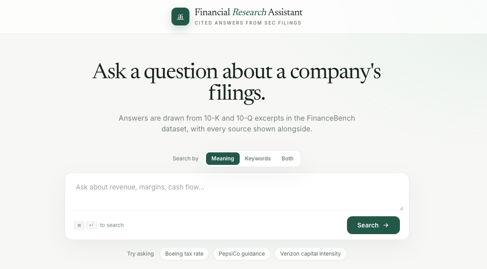

# Financial Research Assistant

Ask a question about a company's SEC filings and get a short answer, with every figure linked back to the passage it came from.



## How it works

Take the question: *"How did Boeing's effective tax rate change from FY2021 to FY2022?"*

**1. Find the evidence**

The app searches 180 excerpts taken from company annual and quarterly reports (10-Ks and 10-Qs) and picks the 10 most relevant. You choose how it searches:

| Option | What it does | Good at |
|---|---|---|
| **Meaning** (default) | Compares what your question is *about* with what each passage is about | Finding the right passage even when it uses different words, e.g. "profitability" → "operating margin" |
| **Keywords** | Looks for passages that share words with your question, giving rarer words more weight | Exact terms, names and figures |
| **Both** | Scores each passage both ways and averages the two | Balancing the two approaches |

For Boeing, this pulls up the income statement from Boeing's 2022 annual report.

**2. Write the answer**

The retrieved document/documents, and nothing else, are given to Claude with three rules: Claude is to only use what's in the passages, label every fact with the passage it came from, and say so if the answer isn't there.

Claude reads the income statement, works out the tax rate for each year (about 14.8% in 2021 and 0.6% in 2022), and notes that it calculated these figures because the filing doesn't state them directly.

**3. Show the sources**

Each fact in the answer Claude gives to your response carries a small numbered tag. Click it to jump to the exact passage it came from. Passages that were retrieved but not used are greyed out, so you can see exactly what the answer relied on.

<details>
<summary>Technical details</summary>

- **Meaning search:** passages are converted to vector embeddings with `all-MiniLM-L6-v2` (sentence-transformers) and stored in ChromaDB.
- **Keyword search:** BM25 via `rank-bm25`.
- **Both:** each method's scores are min-max normalised to 0–1, then averaged 50/50.
- **Generation:** Claude via the Anthropic API, with citations parsed from `[n]` markers and filtered to the ones actually used.

</details>
```

## Does it work?

FinanceBench includes an answer key: for 45 questions, it marks which passage contains the answer. I used it to check how often each search method finds the right passage.

| Search method | Found the right passage (top 10) | How high it ranked (1 = always first) |
|---|---|---|
| Keywords | 37% | 0.21 |
| **Meaning** | **99%** | **0.68** |
| Both | 96% | 0.55 |

**What I learned:** the usual advice is to combine both methods. On this data, meaning on its own won. Keyword search struggles because the benchmark questions are long and wordy, and mixing it in made results worse. So the app searches by meaning by default.

**Caveats:** the dataset is small (180 passages), and this tests finding the evidence, not the quality of the final written answer.

<sub>Metrics: Recall@10 and MRR@10.</sub>

## Running the project locally

```bash
git clone https://github.com/nathandube05/fin-rag-engine.git
cd fin-rag-engine
python3 -m venv .venv && source .venv/bin/activate
pip install -r requirements.txt
cp .env.example .env        # then add your ANTHROPIC_API_KEY
uvicorn server.main:app --reload
```

Open http://localhost:8000. The first start takes a minute while the embedding model downloads and the vector index builds.

```bash
pytest                      # tests (no API key needed)
python -m rag.evaluate      # reproduce the evaluation table
```

## Project structure

```
server/main.py     API: search endpoint, Claude call, rate limiting, serves the page
rag/retriever.py   meaning, keyword and hybrid search
rag/generator.py   prompt building and citation filtering
rag/evaluate.py    Recall@10 and MRR@10 on FinanceBench
rag/ingestion.py   loads the corpus and questions
client/index.html  the single-page interface
tests/             unit tests
data/              FinanceBench corpus, questions and relevance labels
```


## Built with

Python, FastAPI, ChromaDB, sentence-transformers, rank-bm25, the Anthropic API (Claude) and Tailwind CSS.

## Data and licence

Data comes from the [ICAIF '24 FinanceRAG Challenge](https://www.kaggle.com/competitions/icaif-24-finance-rag-challenge/data) on Kaggle.
